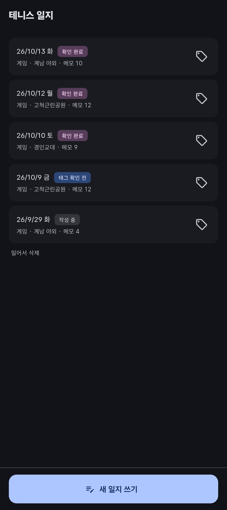
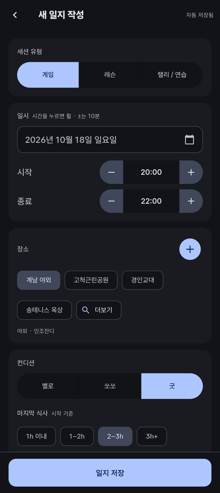
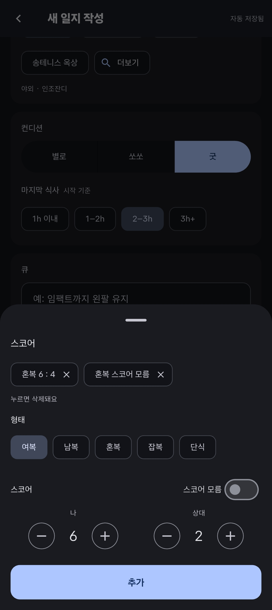
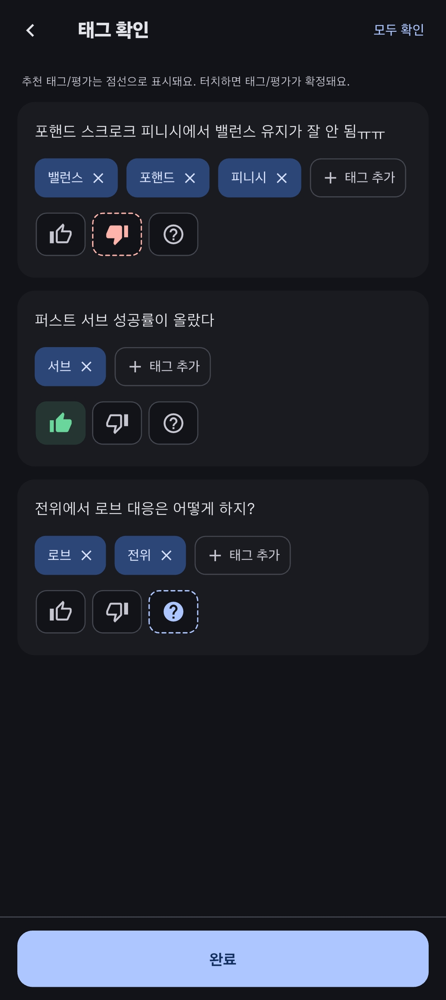

# tennis_log

테니스 게임이 끝난 뒤 기억나는 장면을 메모 한 줄씩 남기면, 메모에 **기술·상황 태그와 잘됨/안됨 평가를 자동으로 붙여 주는** 개인용 게임일지 앱입니다.  
"백발리가 안 된다는 메모가 몇 번 나왔는지", "컨디션이 나쁜 날 어떤 실수가 많은지"처럼 **태그·평가별로 모아 약점을 파악하는 것**이 목표입니다.

평소 게임이 끝나면 아쉬웠던 부분을 핸드폰 메모장에 적어두었습니다.  
그러나 일지가 쌓일수록 점점 불편한 점이 생기기 시작했습니다.

반복되는 문제가 무엇인지, 예전과 지금 무엇이 달라졌는지는 찾기 어려워졌습니다.  
주로 정기 모임에 나가다 보니 장소와 시간은 거의 같은데 매번 다시 타이핑해야 했습니다.  
"이걸 쓴다고 나중에 볼까?" "쓰는 것 자체가 좀 귀찮은데?"라는 생각에 일지 쓰기에 점점 소홀해졌습니다.

이런 문제를 해결하기 위해, **적는 건 빠르게, 원하는 조건의 기록을 모아 보는 건 간편하게** 할 수 있는 앱을 직접 기획하고 만들었습니다.

## 화면

|              일지 목록              |              일지 작성\_1               |              일지 작성\_2               |            태그·평가 확인             |
| :---------------------------------: | :-------------------------------------: | :-------------------------------------: | :-----------------------------------: |
|  |  |  |  |

## 주요 기능

- **2단계 작성 흐름** — 1단계에서 세션 정보(일시·장소·컨디션·식사 시간·큐·스코어)와 메모를 빠르게 적고, 2단계에서 자동으로 붙은 태그와 평가를 확인·수정합니다.
- **규칙 기반 자동 태그** — 태그 58개, 인식 표현 176개, 제외 단어 7개로 된 사전을 기반으로 메모를 분석합니다. 긴 표현부터 매칭하고 매칭된 구간은 다시 쓰지 않아서 "백발리"에 "백"·"발리"가 중복으로 붙지 않고, 띄어쓰기가 달라도("포 스트로크"/"포스트로크") 같게 인식합니다.
- **사용자 판단 우선** — 사용자가 지운 자동 태그는 `rejected`로 기억해 다시 붙이지 않고, 사용자가 확정한 평가는 메모를 고쳐도 덮어쓰지 않습니다.
- **자동 저장** — 화면을 열기만 하면 아무것도 만들지 않고, 처음 입력하는 순간 초안을 만든 뒤 0.8초 디바운스로 저장합니다. 화면을 떠날 때 남은 변경은 즉시 저장합니다.
- **큐(Cue) 추적** — 그날 의식할 한 가지("스플릿 먼저")를 적고, 게임 중 실제로 적용했는지 기록합니다. 지난 큐를 사용 횟수·최근 적용 결과와 함께 다시 불러올 수 있습니다.

## 기술 스택과 선택 이유

후보를 AI와 함께 비교해 보고, 최종 선택은 직접 했습니다.

| 패키지                          | 선택 이유                                                                                                                            |
| ------------------------------- | ------------------------------------------------------------------------------------------------------------------------------------ |
| Flutter                         | 하나의 코드로 Android와 웹 모두 빌드 가능                                                                                            |
| Riverpod 3 + riverpod_generator | 프로바이더가 처음 읽힐 때 생성되어 등록 순서를 신경 쓸 필요가 없음. 실무에서 GetX를 쓰며 겪은 컨트롤러 등록 시점 오류를 피할 수 있음 |
| drift                           | 같은 코드로 Android와 웹(WASM)을 모두 지원하고, 태그·상황별 집계에 SQL과 외래키·제약을 쓸 수 있음                                    |
| freezed 4                       | 화면 상태를 불변 모델로 두어 자동 저장 중 상태 비교·복사를 안전하게 처리                                                             |
| go_router                       | 선언적 트리 구조로 앱 내 모든 경로를 한곳에서 직관적으로 관리, 웹 주소창 연동                                                        |

## 데이터 설계에서 신경 쓴 것

메모 한 줄이 조회·집계의 기본 단위입니다. 나중에 통계를 낼 때 과거 기록이 틀어지지 않도록 다음을 지켰습니다.

**과거 기록이 바뀌지 않게**

- 일지에 장소 id만 두지 않고 저장 시점의 **장소 이름·코트 표면·실내 여부를 스냅샷으로 복사**합니다. 장소 정보를 나중에 고쳐도 지난 일지와 집계는 그대로입니다.
- 메모와 태그는 **이름이 아니라 id로 연결**합니다. 태그 이름을 바꿔도 연결이 끊기지 않습니다.

**삭제의 범위를 관계의 성격으로 정하기**

- "소유" 관계(일지 → 게임·메모 → 메모-태그)는 cascade로 함께 지우고, "참조" 관계(일지 → 장소·큐)는 cascade를 걸지 않아 일지를 지워도 장소·큐는 남습니다. 장소 삭제 기능을 만들 때는 일지의 장소 참조만 비우도록(`SET NULL`) 바꿀 예정이며, 저장 시점의 장소 스냅샷이 있어 지난 일지 표시와 집계는 그대로 유지됩니다.
- SQLite는 외래키가 기본으로 꺼져 있어서 **커넥션을 열 때마다 `PRAGMA foreign_keys = ON`** 을 켭니다. 이게 없으면 위 규칙이 전부 무시됩니다.
- 일지 삭제는 확인 창 대신 **실행 취소**를 제공합니다. cascade로 사라질 행을 지우기 전에 모두 읽어 두었다가, 되돌릴 때 **원래 id와 순서 그대로** 외래키 순서(세션 → 게임 → 메모 → 메모-태그)에 맞춰 복구합니다.

**자동화가 사용자의 결정을 덮어쓰지 않게**

- 태그 연결에 `source`(auto/manual)와 `status`(suggested/confirmed/rejected)를 두어, 다시 저장해도 수동 태그·거부한 태그·확정한 평가는 건드리지 않습니다.
- 내용이 바뀐 메모만 다시 추천하도록 마지막으로 추천을 돌린 내용(`lastTaggedContent`)을 저장합니다.

**저장 형식이 플랫폼·시간대에 흔들리지 않게**

- DateTime을 **ISO-8601 텍스트로 저장**합니다. 날짜 전용 값을 유닉스 시간으로 저장하면 시간대에 따라 하루 밀려 읽힐 수 있어서, 날짜는 로컬 자정으로 정규화해 넣습니다.
- enum은 이름 문자열로 저장되므로, 값 이름을 바꾸면 마이그레이션에서 기존 행을 UPDATE해야 한다는 규칙을 문서로 남겼습니다.

**DB가 막을 것과 화면이 막을 것 나누기**

- 시간 범위(06:00\~24:00)와 컨디션 점수(1\~3)는 **CHECK 제약**으로 DB가 막습니다.
- "종료가 시작보다 이르면 안 된다"는 DB가 막지 않습니다. 자동 저장은 입력 중인 불완전한 상태도 저장해야 하기 때문입니다. 대신 입력 단계에서 그런 값이 **애초에 만들어지지 않게** 했습니다(± 버튼이 10분 간격에서 멈추고 이유를 표시).

**태그 사전이 어긋나지 않게**

- 같은 인식 표현이 여러 태그에 걸릴 수 있어(예: "스핀서브" → #서브, #킥) 인식 표현은 전역 유일이 아니라 **(태그, 표현) 조합으로 유일**하게 두었습니다.
- 태그 사전 시드는 **하나의 트랜잭션**으로 넣어 사전이 절반만 들어간 상태가 남지 않게 했습니다.

## AI와 일하는 방식

기획과 명세는 Claude(웹)와, 구현은 Claude Code(VS Code)와 함께 진행했습니다.

**기획: 이유를 묻고, 납득되면 받아들이기**

처음에는 앱 아이디어와 그동안 써 온 일지 몇 개를 보여 주고, 무엇부터 시작하면 좋을지 함께 논의했습니다. AI의 추가 질문에 답하고, 초안을 받으면 왜 그렇게 제안했는지 물었습니다. 이유가 납득되면 받아들이고, 거기서 떠오른 아이디어를 덧붙여 확장하는 식으로 초기 기획과 명세를 만들었습니다. 직접 만드는 앱이니 최소한 왜 이렇게 되어 있는지는 알고 넘어가고 싶었습니다.

**작업 환경 나누기**

- 기획, 공통 규칙 문서, 기능 명세는 **Claude 웹 세션**에서, 실제 코드는 **VS Code의 Claude Code 세션**에서 작성했습니다. 작업 성격에 따라 세션을 분리해 각 세션의 컨텍스트를 필요한 범위로 한정하고, 토큰 사용량을 효율적으로 관리하기 위해서입니다.
- 구현은 명세의 단계마다 세션을 따로 열었습니다. 단계는 **커밋 하나로 묶을 수 있는 크기**로 나눠서, 나중에 어떤 작업이 어떻게 진행됐는지 찾아보기 쉽게 했습니다.

**명세 → 계획 → 승인 → 구현**

1. **명세** — 기능마다 [`docs/specs/`](docs/specs/)에 화면·동작·예외 규칙과 단위 테스트 기대값까지 적습니다. ([일지 작성 MVP 명세](docs/specs/01_journal_entry.md))
2. **계획** — AI는 바로 코드를 쓰지 않고 변경할 파일, 테이블 변경, 작업 순서를 먼저 제시합니다.
3. **승인** — 계획을 검토하고 확인한 뒤에만 구현합니다. 새 패키지 추가나 명세에 없는 기존 기능 수정도 먼저 묻게 합니다.
4. **구현** — 단계마다 무엇을 만들었고 어떻게 확인하는지 보고받습니다. 구현 중 결정이 바뀌면 **명세를 함께 고칩니다.**

프로젝트 공통 규칙, 데이터 모델, 겪은 함정은 [`CLAUDE.md`](CLAUDE.md)에 모아 두고 매 세션이 이를 읽고 시작합니다.

**어디에 시간을 쓸지 정하기**

모든 걸 똑같이 깊게 볼 수는 없어서, 부분마다 이해하고 넘어갈 깊이를 다르게 정했습니다.

- **가장 오래 고민한 것: 태그 사전** — 일지의 진짜 목적은 나중에 모아 보는 것입니다. 그렇다고 작성 규칙이 많아지면 귀찮아서 또 안 쓰게 됩니다. 그래서 자유롭게 적어도 기술·폼·상황별로 검색과 집계가 되도록, 제가 실제로 쓰는 표현에 맞춰 시드 데이터를 다듬고 태그 사이의 위계(예: 백발리 → 발리)를 정하는 데 시간을 가장 많이 썼습니다.
- **이해하고 넘어간 것: 프로젝트 기반과 데이터 계층** — 앱의 뼈대라 나중에 바꾸기 어렵기 때문에, 시간이 걸려도 가능한 한 이해하고 넘어갔습니다.
- **먼저 만들고 써 보며 고친 것: 자동 태그 엔진과 화면** — 엔진은 세부 구현을 모두 따라가는 데 드는 시간이 커서, 명세에 정한 기대 결과 표를 테스트로 만들고 실제로 써 보며 동작을 검증하는 쪽을 택했습니다. 화면도 첫 화면을 디테일까지 다듬다 시간이 많이 들어서, 이후로는 쓸 때 크게 불편한 결함이 아니면 일단 만들고 나중에 고치기로 했습니다.

**실제로 부딪힌 함정**

- **AI가 짠 구조를 그대로 믿지 않기** — 개발을 시작하고 파일을 직접 살펴보니 구성이 어딘가 어색했습니다. 명세를 만든 세션에 이 구조를 어떤 기준으로 짰는지, 보편적인 방식인지, 아니라면 왜 그렇게 했는지 물었고, "널리 쓰이는 방식 중 하나지만 Flutter 공식 권장 구조와는 data 계층의 위치가 다르다"는 답을 받았습니다. 진행 중인 MVP를 멈추지 않기 위해 일지 작성 MVP까지는 현재 구조로 마치고, 폴더 구조 정리는 다음 작업으로 분리했습니다.
- **설명을 읽고 불필요한 계층 걷어내기** — 태그·평가 확인 화면을 마치고 커밋 메시지를 확인하던 중 "notifier 없이 컨트롤러만 둔다"는 설명이 눈에 걸려 왜 이렇게 구현했는지 물었습니다. notifier를 두지 않은 이유는 납득됐습니다. 반면 컨트롤러는 메서드 7개 중 4개가 리포지토리를 그대로 호출하는 한 줄짜리였고, AI도 근거가 약하다고 인정했습니다. 그래서 커밋 전에 컨트롤러를 걷어냈습니다.
- **의도와 다른 테스트 기대값 수정하기** — AI가 작성한 명세의 테스트 기대값을 보다가 리턴 메모인 "스핀서브 리턴 어렵다"에 #서브가 붙는 걸 발견했습니다. 제외 단어를 "포함"으로 판단하는 규칙으로는 이 경우를 걸러낼 수 없어서 판단 기준을 "겹침"으로 바꾸고, 명세를 먼저 고친 뒤 구현했습니다.
- **AI가 찾은 함정은 규칙으로 남기기** — 구현 중 AI가 직접 발견해 고친 문제도 있었습니다. 웹에서 지운 일지가 새로고침하면 되살아나는 drift 버그(#3864), 이전 버전 API(freezed 3.x 문법, riverpod 3에 없는 `valueOrNull`), 코드 생성기가 drift 클래스를 처리하지 못하는 제약 등입니다. 이런 문제는 원인과 대응을 [`CLAUDE.md`](CLAUDE.md)에 규칙으로 적어 다음 세션이 같은 실수를 반복하지 않게 했습니다.

## 실행

```bash
flutter pub get
dart run build_runner build   # drift, freezed, riverpod 코드 생성
flutter run -d chrome         # 웹(개발용)
flutter run                   # 연결된 Android 기기
flutter test                  # 단위·위젯 테스트 269개
```

## 구조

```
lib/
  app/            라우터, 테마
  core/db/        drift 스키마, 시드, DB 설정
  features/
    home/         일지 목록
    journal/
      data/          리포지토리, 저장 시 자동 태그 적용
      domain/        자동 태그 엔진(순수 Dart), 도메인 모델
      presentation/  작성·확인 화면, 하단 시트, 재사용 위젯
docs/specs/       기능별 명세
```

지금 구조에서 태그, 메모, 세션 리포지토리는 `features/journal/data/` 안에 들어가는데, 앞으로 만들 검색, 통계, 태그 관리가 이걸 전부 다시 씁니다.  
그러면 `features/search`가 `features/journal/data`를 가져다 쓰는 기능 간 의존이 생기는 한계가 있어 아래와 같은 구조로 개편할 계획입니다.

```
lib/
  app/              라우터, 테마
  data/
    db/             drift DB, 테이블, 시드, 마이그레이션
    repositories/   세션, 메모, 태그, 장소, 큐 (모든 기능이 공유)
  domain/
    tagging/        자동 태그 엔진
    models/         여러 기능이 같이 쓰는 모델
  ui/
    core/           칩 그룹, 분할 버튼, 스테퍼 등 공용 위젯
    home/
    journal/        화면, 위젯, notifier만
    (search/, stats/, tags/ ...)
```

## 다음 계획

- 기능 간 공유 계층을 분리하는 폴더 구조 개편 (위 '구조' 참고)
- 태그·상황별 검색과 통계 화면 (예: 컨디션별 bad 메모 비율, 큐 적용률)
- 태그 관리 (이름 변경, 병합, 인식 표현 편집)
- 사용자가 고친 태그로부터 사전 학습
